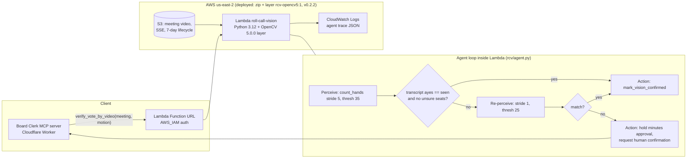

# Roll Call Vision — architecture

OpenCV 5 pipeline per seat ROI: grayscale → Gaussian blur → absdiff vs median baseline (pre-vote frames) → binary threshold → morphological open → external contours → largest-area test; dark-fraction occlusion flag. Per-frame votes aggregated over the vote window (>=50% of frames = aye; 20–50% = unsure).

Live endpoint (IAM): `https://hj6wfy2lilbbllikwriblbsx3m0thfif.lambda-url.us-east-2.on.aws/` — Function URL with AWS_IAM auth (not public). Deploy path is zip function code + OpenCV layer (no container / ECR).
